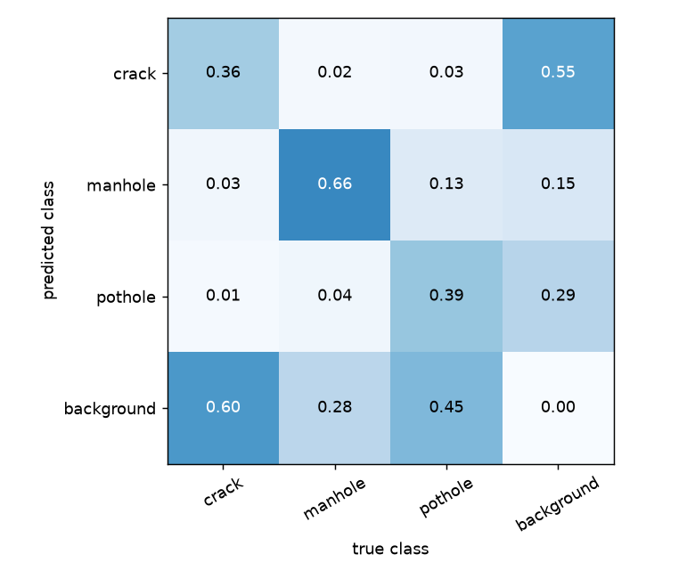
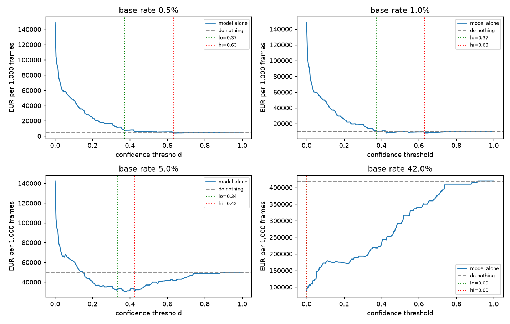

# Assignment 2 Report

- **Name**: Marta Bermejo Villaescusa
- **Student ID**: 18748
- **Email**: mbermejo.ieu2022@student.ie.edu
- **Group**: BBADBA 5B 

## Business problem, and the cost of being wrong

The town hall of a city has to make decisions on where to send employees to make repairs, and which streets to prioritize and improve. My idea would be that some cars drive around with cameras, and by analyzing potholes and streets that are in bad shape, the city can send a technical maintenance team to fix what needs to be fixed. I considered sending an employee in person to inspect each possible location, but this would involve travel and would not scale to around 1,600 cases a day. A site visit would already cost a significant part of the estimated €150 false-positive cost, so checking the image first seems more practical.

The positive class is pothole, and one case is one frame from the camera. I think that usually, when I have a car trip, I may encounter one or two potholes per 15 minutes on average. As a camera can take a picture every 2 seconds, it could take around 450 photos in a 15-minute drive. Also, one pothole may appear in 2 or 3 photos in a row. Therefore, this would account for around 4 pictures with a pothole for every 450 photos, so I assume that 1% of pictures have a pothole worth fixing. This is an estimate, not a measured production base rate.

A false negative would be a real pothole that no one fixes because it is not identified or found. This could lead to the pothole becoming bigger, harming vehicles and becoming more expensive and difficult to fix. A false positive would be sending a repair team to a place that does not need fixing, causing an opportunity cost because the team could have gone somewhere else, as well as the cost of travelling there. It does not generate the same direct harm as a missed pothole. Under my assumptions, a false negative costs around 6.7 times as much as a false positive (€1,000 compared with €150).

For a false positive, I assume €150: three workers for one hour at an estimated €40 per worker-hour (€120 total), plus €30 for fuel and travel. For a false negative, I assume €1,000. Around €400 of this is the repair cost: for example, Diari de Tarragona reported that Cambrils allocated €42,000 to repair around 100 potholes, which is approximately €420 per pothole. The remaining €600 is an illustrative allowance for the pothole becoming worse and for possible vehicle damage or claims from citizens. These are simplified estimates, not verified costs for a particular municipality. Source: Diari de Tarragona, 30 June 2022.

The system would have three possible outcomes. Frames with a low pothole confidence score would be passed without intervention, frames with a high score would be flagged for maintenance, and frames with an intermediate score would be sent for human review. By review, I mean that a person checks the image, verifies the location if possible and records the case before deciding whether a maintenance team should be sent. The reviewer does not travel to the site to inspect every image. A visit would add travel time and costs close to the estimated cost of a false positive, and would be impractical at this volume.

For the operational estimate, I assume two vehicles operate for 12 hours per day, taking one frame every two seconds. This means 43,200 frames per day. I assume that one reviewer can process 400 frames per eight-hour day and costs €200 per day, giving a review cost of €0.50 per frame. This works out to an average of 72 seconds per frame, including checking the image and location, recording the case and allowing for pauses and administrative time. Under these assumptions, five reviewers would be needed for the hybrid system, while manually checking every frame would require 108 reviewers. These are planning assumptions rather than measured productivity figures.

## Dataset

I used the public Roboflow Universe dataset firas / road-damage-detection-cu846, version 2, without forking it: https://universe.roboflow.com/firas/road-damage-detection-cu846/dataset/2

It has 1,404 training, 401 validation and 199 test images, with no augmentations and a stretch resize to 512x512. The classes are crack, pothole and manhole. One image is a frame of the road taken from inside a vehicle, and each object is a bounding box around a road feature. Potholes are my positive class, cracks are a different kind of surface damage, and manholes matter because they can look like a pothole but need no repair.

This dataset serves my problem because my decision is whether to send a repair team to a road segment using video from vehicles that already circulate. It matches that setup and contains pothole as the positive class, and manhole is a natural cause of false positives.

## What the dataset's composition implies

| Class | Train | Valid | Test | Median box (% of image) | Boxes < 1% |
|---|---|---|---|---|---|
| crack | 1796 | 489 | 215 | 1.41 | 38.9% |
| manhole | 684 | 174 | 110 | 0.46 | 86.6% |
| pothole | 913 | 223 | 115 | 0.38 | 81.6% |

Every test image contains at least one object, so I cannot measure how often the model invents a pothole on clean asphalt, and the base rate cannot be taken from the test set. The objects are also very small (82% of potholes cover less than 1% of the image), which makes them hard to detect. The split came pre-made, so I cannot rule out that near-identical frames of the same road appear in both train and test. If they do, the test may be easier than real use.

Manhole has the headline number (AP50 0.72), but it is not the class my decision depends on. Pothole, the class I act on, reaches only 0.43 AP50 and 0.43 recall, below the overall 0.50. The small box size is probably one reason the model misses so many potholes.

## Finetuning and baselines

| Model | mAP50 | AP50 pothole |
|---|---|---|
| Finetuned YOLO11s | 0.496 | 0.428 |
| COCO zero-shot | 0.0 (by construction) | 0.0 (by construction) |
| Predict nothing | 0.0 (by construction) | 0.0 (by construction) |

I trained YOLO11s in Google Colab using a Tesla T4 GPU. The training settings were an image size of 512, batch size 16, seed 0 and patience 15, with a maximum of 50 epochs. The training could stop before reaching the maximum because of early stopping. I chose the YOLO11s variant because the objects are small and a somewhat larger model has more capacity for fine detail. I did not compare it with the n variant, so I cannot say it was better; that is a next step.

The pretrained COCO model only knows 80 everyday object classes, and none of them is pothole, crack or manhole. Used without finetuning it cannot name any of my classes, so its AP50 is 0 by construction. "Predict nothing" scores 0 because it finds no objects. Beating both is therefore expected, and the useful comparison is the finetuned model against doing nothing, in euros.

## Per-class evaluation and failure modes

| Class | Precision | Recall | AP50 | AP50-95 |
|---|---|---|---|---|
| crack | 0.445 | 0.377 | 0.345 | 0.130 |
| manhole | 0.679 | 0.727 | 0.715 | 0.316 |
| pothole (positive) | 0.496 | 0.426 | 0.428 | 0.188 |

The per-class results show that manhole is the best-detected class, with an AP50 of 0.715, while pothole reaches only 0.428 AP50. This distinction matters because pothole is the positive class that drives the maintenance decision.

I calculated the following confusion matrix using my own script, with a confidence threshold of 0.25 and an IoU threshold of 0.45.

The confusion matrix shows that 45 potholes are detected correctly, while 52 are missed entirely. Fifteen are predicted as manholes and three as cracks. Therefore, the main failure mode is not confusion between road-damage classes, but failure to detect potholes at all. This is consistent with the dataset statistics, which show that 81.6% of pothole bounding boxes occupy less than 1% of the image.

The model also produces 42 pothole predictions on background regions in this evaluation. These false positives matter because they can trigger unnecessary inspections or repairs. However, the confusion matrix is based on a particular confidence and IoU threshold, so these counts should not be interpreted as the model's performance at every operating point.

Overall, the model is a useful starting point for road-damage detection, but its current recall is insufficient to justify using it as the sole system for identifying potholes that require repair.

## Cost matrix and operating point
I use €150 as the cost of a false positive and €1,000 as the cost of a false negative. A false positive means sending a team when no repair is needed, while a false negative means missing a pothole that needs fixing. I also assume human review costs €0.50 per frame, based on €200 per reviewer-day and 400 frames checked per day. These are estimates rather than measured municipal costs.

| Decision outcome | Cost per case |
|---|---:|
| False positive (FP) | €150 |
| False negative (FN) | €1,000 |
| Human review | €0.50 per frame |

Using a 1% base rate of actionable pothole frames, the estimated costs per 1,000 frames are:

| Strategy | Threshold / review band | Estimated cost per 1,000 frames |
|---|---|---:|
| Do nothing | No potholes flagged | €10,000 |
| Model alone | Best threshold: 0.425 | €8,297 |
| Model + human review | Review between 0.370 and 0.630 | €5,138 |
| Review every frame | All frames checked by a person | €500 |

The model-plus-review strategy is cheaper than doing nothing or using the model alone, but it is not the cheapest option under these assumptions: reviewing every frame costs less. The practical argument for automated triage is therefore reducing the number of frames that people need to inspect, rather than minimising the estimated cost alone.

The lower and upper thresholds of 0.370 and 0.630 were selected by the cost sweep as the cheapest review band compatible with the capacity of my assumed team of five reviewers. Together, the reviewers can check 2,000 frames per day, equivalent to around 4.6% of the 43,200 daily frames. The selected band sends approximately 3.8% of frames for review, which fits within this capacity. The purpose is not simply to filter uncertain predictions, but to minimise the estimated cost while keeping the review workload manageable for the available staff.

I also tested how the estimated cost changes when the false-negative cost changes:

| FN cost | Do nothing | Model alone | Model + review (lo / hi) | Review share |
|---|---:|---:|---:|---:|
| €400 | €4,000 | €3,333 (0.630) | €2,066 (0.370 / 0.630) | 3.8% |
| €1,000 | €10,000 | €8,297 (0.425) | €5,138 (0.370 / 0.630) | 3.8% |
| €2,000 | €20,000 | €14,011 (0.425) | €10,257 (0.370 / 0.630) | 3.8% |

As expected, the estimated costs increase when a missed pothole becomes more expensive, especially for doing nothing. The review share and hybrid thresholds stay the same in these results, while the best model-only threshold changes between scenarios. This means that the relative cost of missing a pothole affects which model-only threshold is preferred, but does not change the number of frames sent to review in this particular sweep.

The best operating point also depends on the base rate of actionable potholes. In my cost sweep, the hybrid review thresholds are 0.370 and 0.630 at both a 0.5% and a 1% base rate, but change to 0.335 and 0.425 at a 5% base rate. This means the selected hybrid strategy changes when the estimated prevalence rises from 1% to 5%. The thresholds should therefore be treated as scenario results, not as validated production settings. Before deployment, I would collect representative road footage, estimate the prevalence of actionable potholes and repeat the cost sweep using that estimate.

A useful break-even check is to compare doing nothing with reviewing every frame. Reviewing every frame costs €0.50 per frame, while doing nothing has an expected false-negative cost equal to the base rate multiplied by the €1,000 false-negative cost. Therefore, full human review is cheaper than doing nothing whenever the base rate is above 0.05%, assuming the false-negative cost is €1,000 and the review cost is €0.50 per frame. This is a simplified comparison, because it assumes review is perfect and does not account for repeated frames showing the same pothole.

The absolute euro estimates are likely inflated because the cost model charges for each frame independently. The same pothole can appear in several consecutive frames, but it would normally be one defect to repair, not a separate €1,000 loss for every frame. For example, 43,200 frames per day multiplied by a 1% pothole-frame rate and €1,000 per false negative gives €432,000 per day if every pothole frame is charged as a separate missed defect. This is not a realistic estimate of daily municipal losses. A better system would group repeated detections into unique potholes and calculate costs per defect or location rather than per frame.

## What a person still has to check

The system has three possible outcomes: frames with confidence below 0.370 are passed without intervention, frames with confidence at or above 0.630 are flagged for maintenance, and frames between these thresholds are sent to human review.

Under the 1% base-rate scenario, the cost sweep estimates that 3.8% of frames require review. With two vehicles operating for 12 hours per day and capturing one frame every two seconds, this corresponds to approximately 1,626 frames requiring review each day.

Assuming one reviewer can inspect 400 frames per eight-hour day, five reviewers are required. Their combined capacity is 2,000 frames per day, so the expected workload would use approximately 81% of that capacity. Checking 400 frames during an eight-hour day allows an average of 72 seconds per frame. I assume this is realistic if the reviewer is checking a still image rather than travelling to the site, and if the time includes verifying the location, recording the case and short pauses. However, this productivity has not been measured, and it should be tested with real images before deployment.

The assumption of two vehicles is a simple operating scenario rather than a measured requirement. It gives a daily volume of 43,200 frames, which is large enough that manually reviewing everything would require 108 reviewers at 400 frames per day each. With a team of five reviewers, checking every frame is therefore not realistic. The hybrid approach is the most practical of these options for the assumed staffing level because it directs people to uncertain frames instead of requiring them to inspect every image. It is not the lowest-cost option under the assumptions if enough reviewers were available to check every frame.

For comparison, the estimated costs per 1,000 frames at the assumed 1% base rate are €10,000 for doing nothing, €8,297 for the model alone, €5,138 for the model plus human review, and €500 for reviewing every frame. The hybrid strategy reduces the estimated cost relative to doing nothing or using the model alone, while keeping the workload within the assumed capacity of five reviewers. Full human review is cheaper in the simplified cost model, but would require 108 reviewers, which is outside the assumed staffing capacity.

The review process also assumes that people make the correct decision. In practice, some images may be ambiguous and a reviewer could miss a pothole or flag a harmless road feature. Before deployment, I would test reviewer accuracy and actual review speed on a sample of images. I would also verify whether the proposed thresholds provide a useful balance between workload and missed potholes on representative footage.

## Limitations & next steps

- **No clean-road images:** Every test image contains at least one annotated object, so the dataset does not adequately represent the clean-road frames expected in production. I would collect a representative sample of normal road footage, including roads without potholes, and evaluate the false-positive rate on that sample before estimating operational costs.

- **Potential overlap between training and test images:** The dataset uses a predefined split, and I have not verified whether visually similar frames from the same road appear in multiple splits. I would inspect image filenames and visual similarity, then create a road-level or driving-session-level split to test generalisation to unseen roads.

- **Small potholes and low recall:** 81.6% of pothole boxes occupy less than 1% of the image, and pothole recall is approximately 0.43. I would compare YOLO11n and YOLO11s, test a higher input resolution and evaluate whether these changes improve pothole recall without creating too many false positives.

- **Human review is assumed to be perfect:** The current cost calculation assumes that reviewers always make the correct decision. In practice, small or ambiguous potholes may also be missed by humans. I would measure reviewer accuracy on a labelled sample and include human false-positive and false-negative rates in the cost model.

- **Repeated frames and event-level costs:** The same pothole may appear in several consecutive frames or be recorded again on a later journey. Charging the full €1,000 false-negative cost for every missed frame would overstate the financial impact of a single defect. I would group detections across consecutive frames into unique road defects, associate them with road locations and estimate intervention costs per defect rather than per frame.

- **Unvalidated economic assumptions:** The 1% base rate and the €150 and €1,000 error costs are illustrative estimates. I would obtain municipal maintenance and repair records, measure the actual prevalence of actionable potholes in vehicle footage, and repeat the cost sweep across several plausible scenarios before selecting production thresholds.

- **Limited evaluation evidence:** The current results come from one dataset and one trained model configuration. I would compare YOLO11n and YOLO11s on the same test split and then evaluate the selected model on footage from different roads and driving sessions before recommending deployment.

## Generative AI use disclosure

I used Claude for this assignment. It helped write the code for the files of dataset.py, cost_sweep.py and the gradio dashboard. It also gave me the idea to use YOLO11s because of the small size of the objects. 
I still was the one to decide how to frame the problem, interpret the results, give the business framing and ideation, but i did need its help to understand some things that were giving me weird values and understand why it was not so succesful. 
